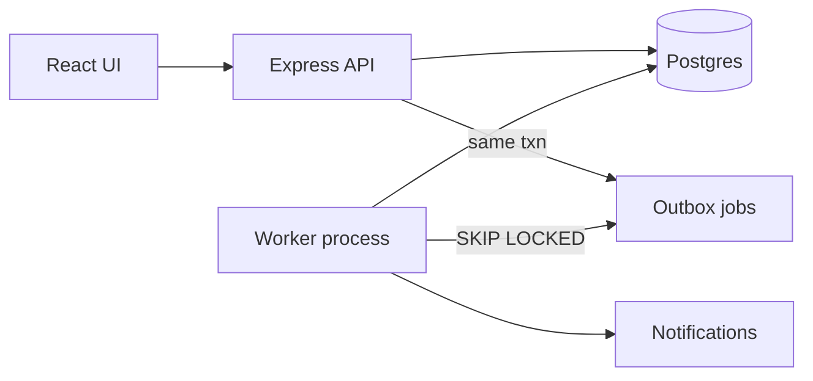

# Operations Under Pressure

Internal work queue for operational requests across teams. Create items, claim or assign ownership, move them through a server-enforced workflow, and keep an append-only activity history. Built for the Newtonite Software Engineering Challenge.

**Repo:** [akhilesh3084/newtonite-ops-2300970100029](https://github.com/akhilesh3084/newtonite-ops-2300970100029)

## Prerequisites

- Docker Desktop (Compose v2)
- Node.js 20+ (only needed to run tests or local Vite/API outside Compose)

## Quick start (reviewer path)

```bash
git clone https://github.com/akhilesh3084/newtonite-ops-2300970100029.git
cd newtonite-ops-2300970100029
cp .env.example .env
docker compose up --build
```

Open **http://localhost:3000** (API serves the built React UI).

Reset data volume:

```bash
docker compose down -v
```

### Local development (optional)

```bash
# Terminal 1 — Postgres only
docker compose up postgres

# Terminal 2 — API
cd server
cp ../.env.example .env   # if you do not already have server/.env
npm install
npx prisma migrate deploy
npx prisma db seed
npm run dev

# Terminal 3 — outbox worker
cd server
npm run dev:worker

# Terminal 4 — Vite UI (proxies /api)
cd web
npm install
npm run dev
```

UI: **http://localhost:5173** · API: **http://localhost:3000**

## Demo credentials

All seeded users share password: **`Demo@1234`**

| Role | Email | Notes |
|---|---|---|
| Admin | `akhilesh.admin@ops.test` | All teams; can approve any item |
| Payments Lead | `akhilesh@ops.test` | Create, claim, assign, approve (not own work) |
| Payments Member | `akhilesh.member@ops.test` | Claim and work; cannot approve |
| Payments Viewer | `akhilesh.viewer@ops.test` | Read-only |
| Support Lead | `sara.lead@ops.test` | Support team |
| Cross-team outsider | `outsider@ops.test` | Platform only — use to demo 404 on Payments items |

## Suggested demo flow

1. Sign in as **Payments Member** → **New item** (type `PAYMENT` or `COMPLIANCE`) → **Claim** → **Submit for approval**.
2. Sign out → sign in as **Admin** → open the item → **Approve** → **Close**.
3. Optional: two browsers claim the same open item — one wins, one gets conflict.

## Tests

```bash
cd server
cp ../.env.example .env   # needs DATABASE_URL_TEST on localhost:5433
docker compose up -d postgres
npm install
npm test
```

One command runs unit + integration tests against Postgres database `newtonite_test` (created by Compose init SQL).

Also: `npm run typecheck`

## Architecture



| Layer | Choice |
|---|---|
| API | Express + TypeScript + Zod |
| DB | PostgreSQL 16 + Prisma |
| Auth | JWT; memberships loaded per request |
| Async | Transactional outbox + worker |
| UI | React + Vite + TanStack Query |

## Behaviour map

| # | Behaviour | Where to look | Proof |
|---|---|---|---|
| B1 | Concurrent claim — one winner | `server/src/items/mutations.ts` (`claimItem`) | `tests/integration/claim.test.ts` |
| B2 | Stale edit rejected (version) | `mutations.patchItem` | `tests/integration/version.test.ts` |
| B3 | Idempotent create | `idempotency/with-idempotency.ts` | `tests/integration/idempotency.test.ts` |
| B4 | Workflow + Lead approval + no self-approve | `items/workflow.ts`, `mutations.transitionItem` | `tests/integration/workflow-api.test.ts` |
| B5 | Team-scoped authz (404 / 403) | `authz/permissions.ts` | `tests/integration/authz.test.ts` |
| B6 | Reliable async outbox | `outbox/*`, `notifications/*` | `tests/integration/outbox.test.ts` |
| B7 | Optimistic claim UI | `web/src/pages/ItemDetailPage.tsx` | Manual / claim rollback on 409 |

More decisions: [ENGINEERING_DECISIONS.md](./ENGINEERING_DECISIONS.md) · indexes/scale: [docs/PERFORMANCE.md](./docs/PERFORMANCE.md)

## Testing strategy

- **Unit:** transition matrix, `can()` matrix, cursor encode/decode (no DB).
- **Integration:** real Postgres + Supertest for claim races, idempotency, authz, workflow, outbox retries.
- Separate DB `newtonite_test`; migrate in global setup; truncate between tests.

## Known limitations

- No sign-up / SSO
- Polling (~15s) instead of websockets
- Single list sort order
- JWT in `localStorage`
- No rate limiting
- Admin UI for failed outbox jobs is API-only (`/api/v1/admin/jobs`)
- A sole Lead who is also assignee needs another Lead or Admin to approve

## Next week I would…

- SSE/websockets for notifications
- Rate limiting and audit export
- Per-team configurable workflows
- Partition or archive large activity history
- Stronger search (Postgres FTS) if volume grows

## License

Submitted as an individual challenge artefact. Demo secrets in `.env.example` are **not** for production.
